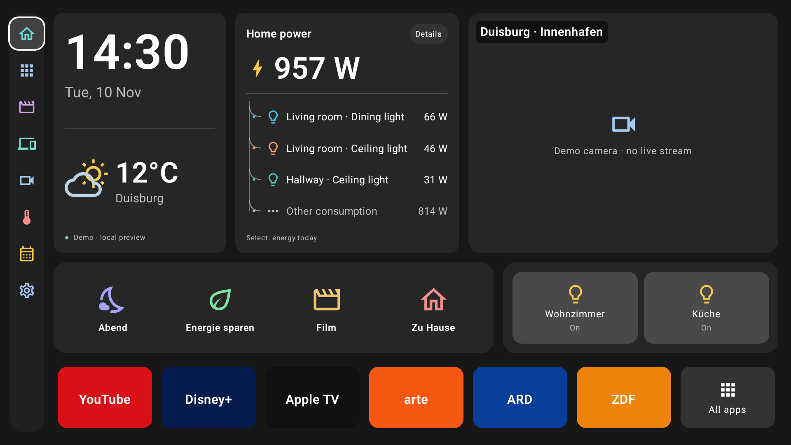

# Open home TV

A lightweight, ad-free Android TV HOME launcher with local Home Assistant integration. Built with Kotlin and Jetpack Compose for TV. No mandatory Google Play Services, accounts, ads, analytics, subscriptions or cloud relay.

**Status: 0.2.0 — phone setup added.** Starts in an interactive demo mode without credentials. Real Home Assistant and camera paths are implemented; compatibility with your HA installation, camera codecs and Sony firmware needs device validation. This is an independent community project, not an official Home Assistant or Sony product.



[German screenshot](docs/images/dashboard-de.png) · [Settings screenshot](docs/images/settings-en.png)

## Set up with your phone

Open **Settings → Set up with your phone** on the TV, scan its QR code and approve the matching number with your remote. Paste the HA URL/token in your phone browser, select sensors, controls, cameras and apps, then **Apply to TV**. A verified connection automatically turns off Demo mode. The temporary local setup server closes afterwards; no phone app, Google service or cloud relay is needed.

[Phone setup and updating instructions](docs/PHONE-SETUP.md) · [TV pairing screenshot](docs/images/phone-setup-tv.png)

Use a trusted private home network. Setup API payloads are encrypted; the local HTTP bootstrap page is not authenticated against active network tampering. See the guide's security model.

## Dashboard

- Dark translucent cards, a static vector dusk landscape, 16:9 layout scaled for 1080p/4K, visible D-pad focus and English/German system localization.
- User-selected installed TV apps, ordering, custom labels/icon initials and HDMI shortcuts when the TV exposes passthrough inputs. The Apps screen retains access to all discovered launchable apps.
- HA weather entity, current temperature/humidity/wind, hourly/daily forecasts and Celsius/Fahrenheit display.
- Animated Canvas energy flows for solar, grid, battery, EV, heat pump and household. Configure sensors in W/kW/MW. Negative battery/grid power reverses animation; missing data stays missing.
- Scenes, lights, switches, covers and climate temperature controls with real-time HA state updates and unavailable-state handling.
- Camera fullscreen playback, optional two-feed dashboard previews, go2rtc WebRTC preference and Media3 HLS fallback. Cameras stop when hidden. Demo camera tiles are explicitly labeled; they do not pretend to show a live feed.
- HA URL/token settings, connection testing, entity selection, camera endpoints, app selection, widget order, panel appearance and optional animation.
- Android TV HOME registration, normal TV app entry, Android settings access, and safe return to the stock launcher.

The attached concept is the layout reference. This release uses a lightweight vector background and installed app icons rather than bundled photographic wallpaper or third-party brand assets.

## Build

Requires **JDK 17**, **Android SDK platform 35** and an Internet connection to resolve build dependencies once. Android Studio can install the required SDK and open this directory directly.

```sh
git clone https://github.com/Mosher23/Open-home-TV.git
cd Open-home-TV
# Set ANDROID_HOME to your Android SDK, or use Android Studio's local.properties.
./gradlew assembleDebug testDebugUnitTest lintDebug
```

Windows: use `gradlew.bat`. The checked-in Gradle wrapper pins Gradle 8.11.1 with distribution checksum verification. Android Gradle Plugin 8.7.3 and Kotlin 2.0.21 are pinned. Dependency versions are deliberately reproducible; AndroidX libraries come from Google's Maven repository but do not require Google Play Services on the TV.

APK: `app/build/outputs/apk/debug/app-debug.apk`. Minimum TV Android version: **8.0 / API 26**. The GitHub Actions workflow builds a debug APK and uploads it under **Actions → Android → build → Artifacts → Open-home-TV-debug**. Debug APKs are for development; a production release should use your own signing key outside the repository. For in-place updates, use the same signing key as the installed APK; fresh CI debug builds may have different keys.

## Install on Sony BRAVIA

See [Sony installation and recovery](docs/SONY-BRAVIA.md) for pairing, firmware differences, default HOME selection and recovery. Quick start after connecting ADB:

```sh
adb install -r app/build/outputs/apk/debug/app-debug.apk
adb shell am start -n dev.hatv.launcher/.MainActivity
```

Select this app as the default Home app only after checking navigation. This app never disables or uninstalls the Sony/Google launcher. Android launches the selected HOME activity automatically where firmware supports it; there is no background boot service.

## Connect Home Assistant

The recommended route is [phone setup](docs/PHONE-SETUP.md). Manual entry with the TV remote remains available:

1. Use the demo dashboard first. Apps in the demo strip are sample tiles; select real installed apps in Settings → Choose and order apps.
2. In HA, create a long-lived access token from a suitable dedicated user's profile.
3. Enter the local HA server URL and token in launcher Settings. Test the connection. Disable Demo mode and Save to connect.
4. Reopen Settings → Choose entities. Pick weather, power sensors, controls and cameras. Camera selection is independent of controls.
5. Back to the main Settings screen and **Save**. Selection changes remain a draft until saved. Widget selection moves that widget to the first slot within its row.
6. For WebRTC, optionally enter a go2rtc HTTP SDP endpoint such as `http://go2rtc.local:1984/api/webrtc?src=front_door`. Leave HLS blank to request a stream from HA. Preview streams opt in; they are disabled by default to save RAM.

The token is encrypted with AES/GCM using Android Keystore and excluded from backups. Standard TLS validation is enforced. HTTP is allowed for local compatibility and sends the token without transport encryption; use HTTPS when available. Changing the server URL requires re-entering a saved token. Tokens are never sent to a different camera origin. Camera URLs must not contain embedded username/password credentials. Settings are private app data.

HA REST is used for connection tests/service actions; one authenticated WebSocket provides entity subscriptions, stream requests and forecasts. It reconnects with bounded exponential backoff and stops retrying invalid credentials. All subscriptions and forecast work stop while the Activity is hidden. App shortcuts work independently of HA.

## Camera and hardware limits

- WebRTC implements go2rtc's HTTP SDP endpoint using the device's Android System WebView. Native HA WebRTC signaling is not implemented; cameras without a go2rtc endpoint use HA HLS.
- Direct LAN ICE is used with no external STUN/TURN service. WebView support, codecs, camera integration, LAN routing and TV decoder limits determine playback compatibility. HLS is the fallback.
- At most two preview players or one fullscreen player are active. Prefer low-resolution camera substreams. Additional selected cameras are accessible from the Cameras screen without starting hidden streams.
- Sony default-launcher restrictions and HDMI visibility vary by firmware. They cannot be bypassed by a normal application.
- Custom app icons currently support installed package icons or short text initials; arbitrary image import and drag-and-drop widget sizing are future extensions. Widget order is configurable within each row, with three large and three compact slots.

## Development and validation

[Architecture](docs/ARCHITECTURE.md) · [Validation and hardware checks](docs/VALIDATION.md) · [Contributing](CONTRIBUTING.md)

Protocol tests exercise authentication, invalid-token handling, state snapshot/event ordering, reconnection, command responses, REST authorization and URL/unit validation. Live-camera and physical-BRAVIA tests require your own test hardware and HA endpoints. See the validation report for measured emulator results and remaining checks.

Primary API references: [Compose for TV](https://developer.android.com/training/tv/playback/compose), [HA WebSocket API](https://developers.home-assistant.io/docs/api/websocket/), [HA REST API](https://developers.home-assistant.io/docs/api/rest/), [go2rtc](https://github.com/AlexxIT/go2rtc).

## License

[MIT](LICENSE). See [third-party notices](THIRD_PARTY_NOTICES.md) for dependency licenses. Demo service names are descriptive references; no third-party logos or camera images are bundled.
