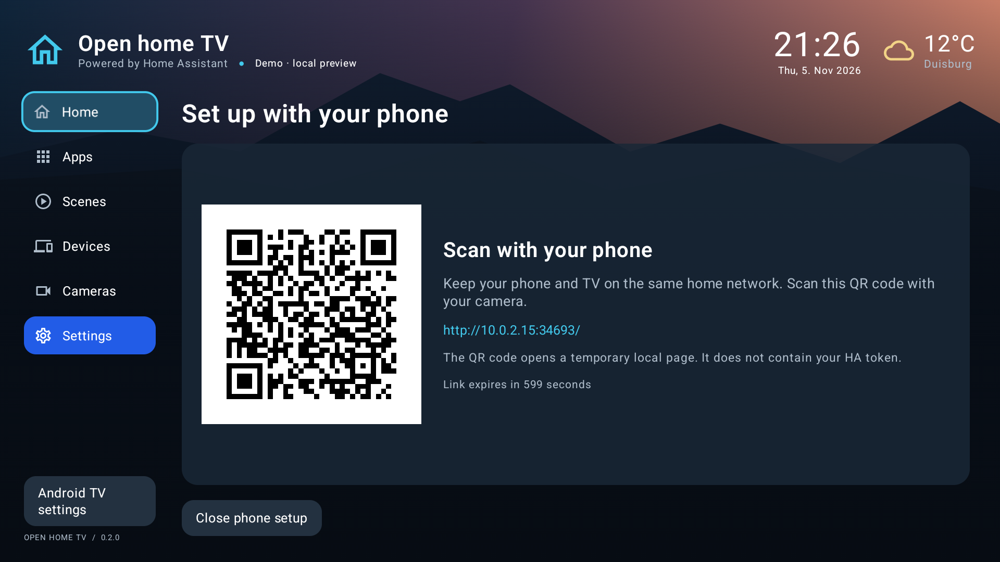

# Set up with your phone — version 0.2.0

You can paste the Home Assistant token and configure dashboard content in your phone's browser. Nothing needs to be installed on your phone. Google Play Services and an Internet connection are not needed for the setup page.

1. Update the launcher APK, then open **Settings → Set up with your phone** (German: **Einstellungen → Mit dem Telefon einrichten**).
2. Keep the TV and phone on the same trusted home network. Scan the QR code on your **TV** with your phone's camera. Keep that TV screen open.
3. Compare the six-digit number on the phone and TV, then select **Allow phone / Telefon erlauben** on the TV remote.
4. On the phone, enter the HA URL and paste the long-lived access token. Choose **Connect and load devices**. For an existing connection, leave the token blank to keep it for the same server. The token input is cleared after a successful connection test.
5. Choose weather, power sensors, lights/switches/scenes/climate/covers, cameras and installed apps. Use the app arrows to set their order. Optional camera endpoint fields are under each selected camera's **Stream options**. Leave them empty to request HLS from HA. Live dashboard previews are off by default.
6. Choose **Apply to TV / Auf TV übernehmen**. The choices and any replacement token are saved together. A verified HA connection automatically turns off Demo mode. The TV returns to Home and closes the setup server.

You can choose apps and appearance without connecting HA; that preserves the existing HA configuration and Demo setting. Connecting for a test and browsing entities do not save the token or configuration until Apply. No HA service actions are executed by this setup page.



The QR in this example has expired. Use the QR generated by your own TV.

## Power sensors and choices

The six power roles are Solar, Grid, Battery, Heat pump, EV charger and other Household consumption. Choose instantaneous W/kW/MW sensors, not cumulative kWh readings. Use positive grid power for import and positive battery power for discharge. Leave unused roles unselected. The main dashboard's center total needs all three supply roles (solar, battery and grid) mapped; an unmapped supply remains unknown rather than being assumed zero.

Entity lists show up to 200 results per query; search by friendly name or entity ID to find more. Up to 100 controls and 12 cameras can be selected. Only the first two cameras preview on Home; the Cameras page lists all selected cameras. The phone page lists up to 200 installed app shortcuts and can save up to 100 selections. Existing widget order is preserved; changing widget placement remains available on the TV.

## Ending setup and troubleshooting

- The session expires ten minutes after opening it on the TV. Applying, closing the TV setup page, navigating away or putting the app in the background closes the listener and discards unsaved credentials.
- Reloading the phone page clears its temporary pairing key. Start a new pairing on the TV and scan the new QR. A session is bound to the first paired browser; another phone requires a new session.
- If the page cannot open, check that the phone can reach the TV's displayed IPv4 address. Guest Wi-Fi/client isolation, separate VLANs and VPN routing can prevent this. This release requires an IPv4 LAN address on the TV's Wi-Fi or Ethernet connection.
- The URL printed beside the QR is for diagnosing network reachability. Opening that bare address does not authorize setup: the QR also carries the one-time key in its URL fragment.
- If the TV setup screen was interrupted by standby or another app, choose **Start new pairing**.

## Security model

The QR carries a fresh random 256-bit pairing key in its URL fragment. It contains no HA token. The browser removes the fragment from its address/history and keeps the key only in memory. Requests and replies use AES-256-GCM with fresh nonces, direction-specific associated data, replay rejection and response/request binding. The server checks Host and Origin, rejects cross-origin/chunked/oversized requests, uses bounded workers and closes automatically. Approval is required on the TV before the browser can read configuration or test HA credentials. Saved tokens remain encrypted with Android Keystore.

**The bootstrap page is served over local HTTP, not authenticated HTTPS.** Encrypted API payloads protect against passive interception, but an active attacker who can alter the initial HTML/JavaScript could defeat that protection. Use this feature only on your trusted private home network. It is not intended for public Wi-Fi or an Internet-exposed port. No router port forwarding is needed. HTTPS for the TV-to-HA connection is a separate setting and remains recommended where available.

## Updating an existing installation

Use an APK signed with the same key as your installed version:

```sh
adb install -r app/build/outputs/apk/debug/app-debug.apk
```

A local build from the same project/toolchain uses the existing local debug key, so the in-place update preserves configuration and the stored HA token. Fresh GitHub Actions runners can use a different debug key; APKs from different signing keys cannot update each other. If Android reports `INSTALL_FAILED_UPDATE_INCOMPATIBLE`, do not uninstall if you want to preserve data—use the original signing key/source to build the update. A production distribution should use a maintained release signing key.

## Editing the browser page

The APK includes the generated assets, so normal Gradle builds do not need Node.js. To change the phone page:

```sh
npm --prefix web/phone ci --ignore-scripts
npm --prefix web/phone test
npm --prefix web/phone run build
./gradlew assembleDebug
```

CI runs the browser protocol tests and checks that the generated bundle matches its source. For a browser-only development fixture (no real HA requests or device changes):

```sh
./gradlew -I web/phone/preview.gradle phoneSetupPreview
```

The fixture writes a temporary URL to `.tools/phone-preview.json`. Use `fixture-token` for its simulated HA connection. It automatically approves its test browser; production always requires TV approval. Applying writes a fixture result and stops the preview.
